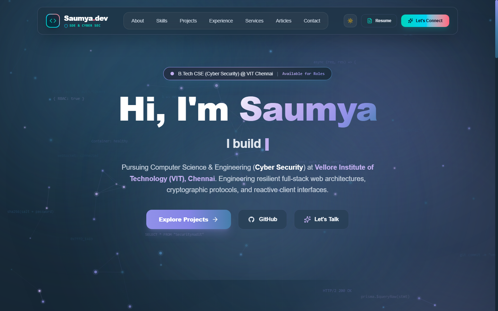
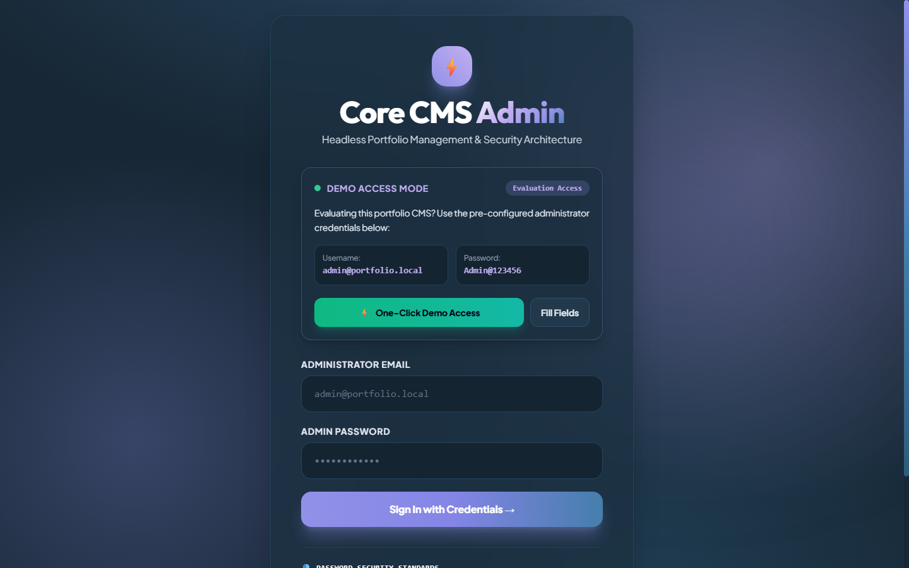
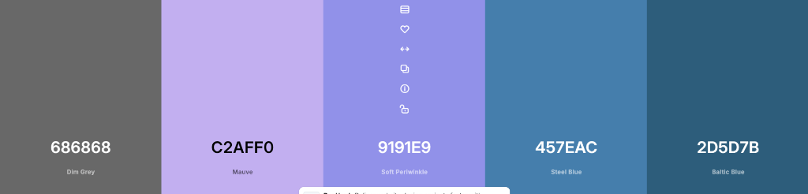

# 🎨 DevFolio Web — Reactive Client Application

> A modern, luxury developer portfolio frontend engineered with React, Tailwind CSS, and interactive HTML5 Canvas graphics, dynamically connected to a decoupled Headless CMS backend.

---

## 📸 Interface Previews

### Hero Section & Cyber Constellation Network


### Headless CMS Administration Interface


### Curated 5-Color Palette


---

## 🛠 Tech Stack

- **Client Framework:** [React](https://react.dev/) (v18+)
- **Build Tooling:** [Vite](https://vitejs.dev/)
- **Styling Architecture:** [Tailwind CSS](https://tailwindcss.com/)
- **Icons & Visuals:** [Lucide React](https://lucide.dev/)
- **Canvas Visuals:** Native 60 FPS HTML5 Canvas with custom node physics & wave dynamics
- **Data Layer:** Unified REST API Client (`lib/api.js`) with automatic offline fallback data store

---

## ✨ Design System & Interactive Features

1. **Cyber Constellation & Mathematical Physics Background:**
   - 65+ interactive interconnected vector nodes that dynamically cluster and form connective laser lines.
   - Real-time mouse cursor repulsion field and click shockwave ripple dynamics.
   - Floating engineering and mathematical notation tokens (`O(log n)`, `e^(iπ) + 1 = 0`, `∇ × E = -∂B/∂t`, `0x7FFD_004A`, `JWT.verify(token)`).
   - Moving ambient aurora gradient meshes with 150px Gaussian blurs.

2. **Tailored 5-Color Aesthetic Palette:**
   - **Dim Grey** (`#686868`): Neutral contrast & borders.
   - **Mauve** (`#C2AFF0`): Primary luminous highlights & badges.
   - **Soft Periwinkle** (`#9191E9`): Active glowing gradients & buttons.
   - **Steel Blue** (`#457EAC`): Secondary structural glow orbs.
   - **Baltic Blue** (`#2D5D7B`): Deep background shadows & glass containers.

3. **Dynamic Decoupled Headless CMS Integration:**
   - Asynchronously queries the backend REST API on boot.
   - Seamless offline fallback state ensures the client always displays full content even during backend maintenance or connection drops.
   - Fast load time with zero layout shift.

4. **Public Testimonials & Endorsement Portal:**
   - Interactive **"✍️ Write an Endorsement"** modal allowing visitors and collaborators to submit recommendations directly to the database.
   - Submissions route to the Headless CMS moderation queue for verification.

5. **Engaging Micro-Interactions:**
   - Dynamic typewriter effect showcasing engineering specializations.
   - Frosted glass cards with `backdrop-filter: blur(20px)` and responsive hover lifts.
   - Interactive contact form drawer with validation and toast alerts.

---

## 📁 Repository Structure

```
devfolio-web/
├── docs/
│   └── screenshots/          # Showcase captures of the frontend and admin interfaces
├── public/
│   ├── favicon.svg           # Vector branding icon
│   └── _redirects            # Single-page application routing rules for Netlify/Vercel
├── src/
│   ├── components/           # Modular UI blocks
│   │   ├── AboutSection.jsx  # Biography & engineering focus
│   │   ├── BlogSection.jsx   # Article previews & reading links
│   │   ├── ContactDrawer.jsx # Sliding drawer contact modal
│   │   ├── ExperienceSection.jsx # Career & education timeline
│   │   ├── Footer.jsx        # Navigation links & copyright
│   │   ├── Hero.jsx          # Typewriter & action triggers
│   │   ├── Navbar.jsx        # Glassmorphic top navigation bar
│   │   ├── ProjectsSection.jsx # Showcase cards with tag filtering
│   │   ├── ServicesSection.jsx # Offerings & capabilities
│   │   ├── SkillsSection.jsx # Categorized competencies & meters
│   │   └── TestimonialsSection.jsx # Peer reviews & submission modal
│   ├── data/
│   │   └── portfolioData.js  # Offline resilient fallback data cache
│   ├── lib/
│   │   └── api.js            # Asynchronous REST API fetching client
│   ├── App.jsx               # Root layout container
│   ├── index.css             # Base styles & custom animations
│   └── main.jsx              # Application bootstrap
├── package.json              # NPM dependencies & scripts
├── vite.config.js            # Vite build configuration & server settings
└── README.md                 # Technical documentation
```

---

## ⚡ Getting Started

### 1. Installation
```bash
git clone https://github.com/Saumya-01git/devfolio-web.git
cd devfolio-web
npm install
```

### 2. Environment Configuration
Create a `.env` file in the project root:
```env
# URL pointing to the running backend CMS API
VITE_API_URL=http://localhost:5000/api
```

*(Note: If the backend is offline, the frontend will automatically load the resilient cached dataset).*

### 3. Start Development Server
```bash
npm run dev
```
Open [http://localhost:5173](http://localhost:5173) in your browser.

### 4. Build for Production
```bash
npm run build
```
The optimized bundle will be generated inside the `dist/` directory ready for static hosting.

---

## 🚀 Deployment

### Vercel Deployment
1. Import the `devfolio-web` repository into Vercel.
2. Select Framework Preset: **Vite**.
3. Set the Environment Variable:
   * `VITE_API_URL`: Your deployed backend API URL (e.g., `https://core-cms-api.onrender.com/api`).
4. Click **Deploy**.

### Netlify Deployment
1. Connect the Git repository to Netlify.
2. Build command: `npm run build`
3. Publish directory: `dist`
4. The included `public/_redirects` file ensures clean client-side routing on hard refreshes.

---

## 📄 License
This project is licensed under the [MIT License](LICENSE).
